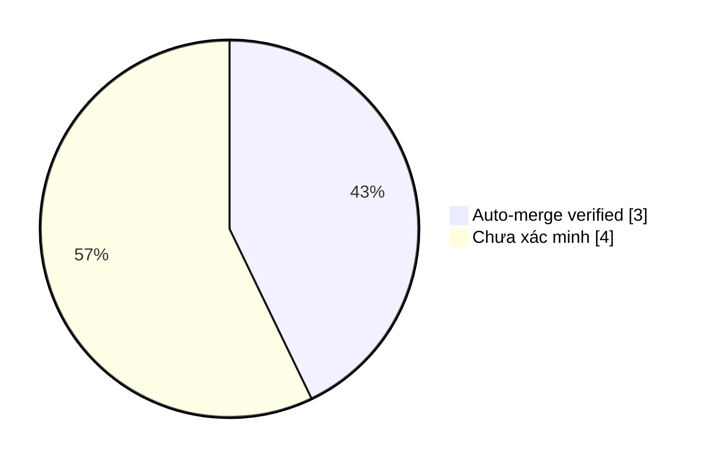

# Auto-Merge Collector · Evidence & Smart Insights

> Dữ liệu GitHub API; chỉ đánh dấu **AUTO-MERGED (verified)** khi collector
> nhận tín hiệu từ workflow auto-merge và xác thực PR, SHA cùng CI xanh.
> Các PR lịch sử không có bằng chứng được ghi **chưa xác minh nguồn merge**,
> không tự suy đoán là merge thủ công hay tự động.

Cập nhật: **2026-11-11 03:59 UTC** · Repository: `duykhang68/reddit-editor`

## 📊 Dashboard

| Chỉ số | Giá trị |
|---|---:|
| PR đã merge (tối đa 300 PR gần đây) | 7 |
| AUTO-MERGED có bằng chứng | 3 |
| Auto-merge PR thường | 3 |
| Auto-merge PR thay đổi workflow | 0 |
| Nguồn merge chưa xác minh | 4 |

### Phân bố bằng chứng

`Auto-merge ` ████████░░░░░░░░░░ **3/7**

## ✅ Vì sao từng PR được auto-merge?

| PR | Thời điểm UTC | Loại | CI HEAD | Bằng chứng & lý do |
|---|---|---|---|---|
| [#8](https://github.com/duykhang68/reddit-editor/pull/8) fix(ui): stop Rollback Dashboard redirecting to depreca | 2026-11-11T03:59:01Z | Code/docs | ✅ | CI green trên HEAD `0c70b66a`; GitHub chấp nhận merge; [Run #42956213279](https://github.com/duykhang68/reddit-editor/actions/runs/42956213279) |
| [#5](https://github.com/duykhang68/reddit-editor/pull/5) infra(staging): isolate Cashflow D1, R2, Worker and Pag | 2026-11-11T03:35:38Z | Code/docs | ✅ | CI green trên HEAD `2435dd60`; GitHub chấp nhận merge; [Run #42953760926](https://github.com/duykhang68/reddit-editor/actions/runs/42953760926) |
| [#4](https://github.com/duykhang68/reddit-editor/pull/4) docs: backend readiness audit and safe Cloudflare stagi | 2026-11-11T03:13:10Z | Code/docs | ✅ | CI green trên HEAD `8082ec23`; GitHub chấp nhận merge; [Run #42951247495](https://github.com/duykhang68/reddit-editor/actions/runs/42951247495) |

## 🧠 Smart Insights

- **Tỷ lệ workflow trong các auto-merge đã xác minh:** 0.0% (0/3).
- **Quality gate:** 3 auto-merge có bằng chứng CI thành công trên SHA chính xác.
- **Bài học:** Kiểm tra SHA hiện tại giúp tránh dùng kết quả CI của commit cũ.
- **Bài học:** PR thay đổi GitHub Actions cần credential đủ quyền `Workflows: write`; CI xanh không tự cấp quyền.
- **Bài học:** Branch protection và khả năng merge do GitHub thực thi; collector chỉ phản ánh kết quả đã xảy ra.
- **Khoảng trống dữ liệu:** 4 PR đã merge chưa có bằng chứng collector; không tính là auto-merge.

## 🛡️ Giới hạn và phương pháp

- Chỉ tính những PR đã merge trong tối đa 300 PR đóng gần đây; dữ liệu tổng hợp không phải toàn bộ lịch sử.
- Collector ghi nhận sự kiện do workflow gửi, xác thực tên run, PR merged, exact SHA và CI check thành công.
- Trạng thái không conflict / branch rules được GitHub thực thi lúc merge thành công; không lưu ảnh chụp ruleset lịch sử.
- CI xanh là điều kiện cần, không phải bảo đảm thay đổi không có lỗi. Insights là quy tắc phân tích, không phải nhận định AI sinh tự động.
- Tệp sự kiện: `data/collector-events.json`; script tạo báo cáo: `collector.py`.
